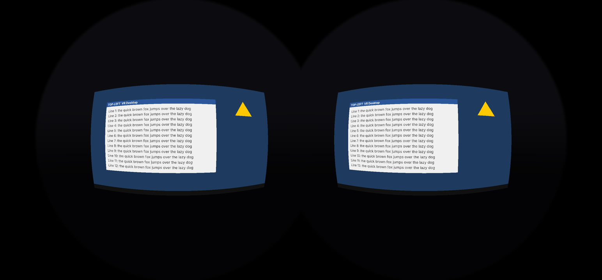

# vr-desktop-android

The Android VR client for **VR Desktop**. It receives the Windows PC's screen from
[vr-desktop-host](https://github.com/ramyemad95/vr-desktop-host) (Sunshine) and shows it as a virtual screen in
a Cardboard-style phone VR viewer. Head tracking keeps the screen fixed in space.

The target phone is the **Samsung Galaxy S22 Ultra**. Other Android 5.0+ phones work too.



*CPU render of the renderer's math at the S22 Ultra's WQHD+ resolution, with a test desktop. Through the lenses,
the two barrel-shaped images merge into one flat screen.*

## What it is
A fork of [Moonlight Android](https://github.com/moonlight-stream/moonlight-android) 12.2 (GPL-3.0, so this repo
stays open source). Pairing, the PC list, decoding, audio and input all come from Moonlight unchanged. What VR Desktop
adds:

- **VR mode** (on by default): the decoder renders into a GPU texture, and an OpenGL ES renderer draws it as a
  virtual screen 2 m in front of you, once per eye, with Cardboard lens correction. See
  [docs/VR-RENDERER.md](docs/VR-RENDERER.md).
- **Head tracking** from the phone's rotation sensor. Tap the screen, or press the viewer's button, to bring the
  virtual screen back in front of you.
- **Settings → VR Settings**: VR mode on/off, the viewer's lens type, the virtual screen size, sharpness, head
  tracking on/off, the refresh rate, and a stats panel (network status, PC encode and phone decode times) below the
  virtual screen.
- **Resolution: match the PC** (with the VR Desktop Host app): the stream follows the PC display's mode, so a
  fullscreen game at 1080p streams at 1080p and the desktop at 4K, with the bitrate set to match. See
  [docs/PROTOCOL.md](docs/PROTOCOL.md) (v1).
- **Picture settings**: screen brightness held while streaming (the headset covers the light sensor), HDR white
  level and highlight compression, Color and Contrast, to tune the picture toward a TV's.
- **Color space (HDR)**: "Native" shows HDR colors in the phone screen's full color range, like a TV's Native color
  space; "Auto" converts them to sRGB.
- **FC 27 mode**: a fixed 1080p HDR stream from the start, for EA SPORTS FC 27, with no reconnects when the game
  starts or ends.
- **Its own app ID** (`io.github.ramyemad95.vrdesktop`) and name, so it installs next to the real Moonlight.

```
MediaCodec (HEVC, low latency) → SurfaceTexture (GL_TEXTURE_EXTERNAL_OES, stays on the GPU)
  → per-eye mesh with inverse lens distortion → per-pixel ray vs. virtual screen → sample the video
```

Stack: Java (like the Moonlight code it builds on) and C via the NDK (Moonlight's network core). The VR renderer is in
[`app/src/main/java/com/limelight/vr/`](app/src/main/java/com/limelight/vr/).

## Status
- Written and checked so far: the VR code compiles against the Android SDK, the lens and head-tracking math has unit
  tests, and the shaders pass the GLSL ES validator.
- **Not yet tested on a phone.** The first real test is on the S22 Ultra. See [docs/SETUP-MAC.md](docs/SETUP-MAC.md).

## Build
```bash
git clone --recurse-submodules https://github.com/ramyemad95/vr-desktop-android.git
```
Open it in Android Studio and run the `nonRootDebug` variant, or use the command line:
```bash
./gradlew assembleNonRootDebug
```
The APK is written to `app/build/outputs/apk/nonRoot/debug/`. Every push also builds it on GitHub Actions
(the **Android build** workflow), so you can download the APK from the run's artifacts.

## Layout
| Path | Purpose |
|------|---------|
| `app/src/main/java/com/limelight/vr/` | VR renderer, lens model, head tracking |
| `app/src/test/java/com/limelight/vr/` | Unit tests for the VR math (run with `./gradlew testNonRootDebugUnitTest`) |
| `app/` (everything else) | Moonlight Android |
| `docs/` | Mac setup, protocol notes, VR renderer design |
| `scripts/update-moonlight.sh` | Pulls newer Moonlight releases into this fork |

## Updating Moonlight
The fork keeps Moonlight's history, so upstream fixes merge normally. See `scripts/update-moonlight.sh`.

## License
GPL-3.0, inherited from Moonlight ([LICENSE.txt](LICENSE.txt)). Moonlight is by Cameron Gutman, Diego Waxemberg,
Aaron Neyer, Andrew Hennessy and contributors.
